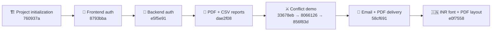
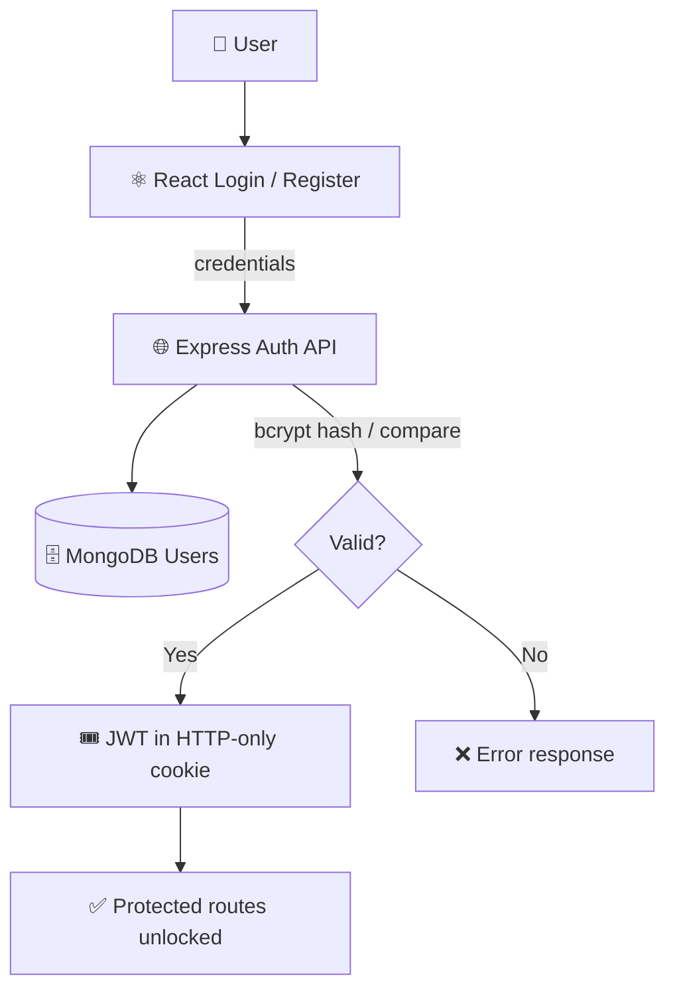
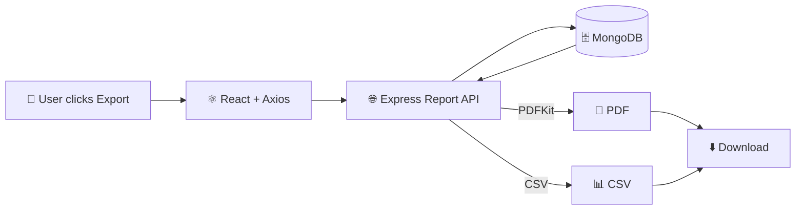
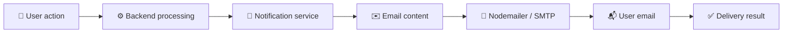
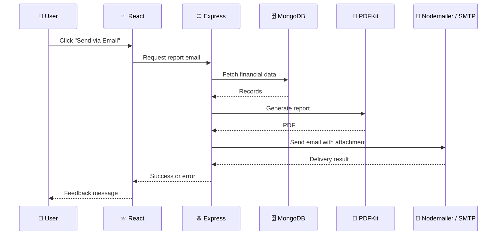
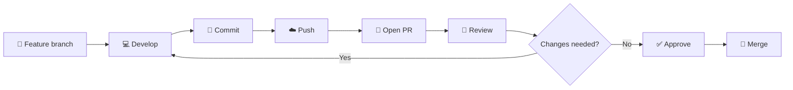

<div align="center">

# ✨ FINORA

# 🌟 Individual Contribution Record

### _Personal Finance & Expense Management System_

**👩‍💻 Divya Shakti** · [`@DivyaShaktiCodingWorld`](https://github.com/DivyaShaktiCodingWorld)


_Advanced Tools and Applications · MCA · SEC101 · Project Development Using Git, GitHub and Markdown_

</div>

---

## 📑 Contents

|  #  | Section                                                                                    |
| :-: | ------------------------------------------------------------------------------------------ |
|  1  | [Project & Role](#-1-project--role)                                                        |
|  2  | [Contributions at a Glance](#-2-contributions-at-a-glance)                                 |
|  3  | [Project Initialization](#-3-project-initialization)                                       |
|  4  | [Authentication & Security](#-4-authentication--security)                                  |
|  5  | [PDF Reports, CSV Export & INR Support](#-5-pdf-reports-csv-export--inr-support)           |
|  6  | [Email Notifications & PDF Delivery](#-6-email-notifications--pdf-delivery)                |
|  7  | [Branches](#-7-branches)                                                                   |
|  8  | [Pull Requests](#-8-pull-requests)                                                         |
|  9  | [Code Review Participation](#-9-code-review-participation)                                 |
| 10  | [Merge Conflict Demonstration & Resolution](#-10-merge-conflict-demonstration--resolution) |
| 11  | [Secure Development Practices](#-11-secure-development-practices)                          |
| 12  | [Verified Commit History](#-12-verified-commit-history)                                    |
| 13  | [Overall Impact](#-13-overall-impact)                                                      |
| 14  | [Skills & Learning Outcomes](#-14-skills--learning-outcomes)                               |
| 15  | [Final Statement & References](#-15-final-statement--references)                           |

---

## 💎 1. Project & Role

|                 |                                                                                   |
| --------------- | --------------------------------------------------------------------------------- |
| **Project**     | Finora – Personal Finance & Expense Management System                             |
| **Subject**     | Advanced Tools and Applications                                                   |
| **Assignment**  | Project Development Using Git, GitHub and Markdown                                |
| **Contributor** | Divya Shakti                                                                      |
| **Repository**  | [DivyaShaktiCodingWorld/Finora](https://github.com/DivyaShaktiCodingWorld/Finora) |
| **Stack**       | React.js · Node.js · Express.js · MongoDB · Mongoose                              |

**About Finora:** a full-stack web application that helps users organize their finances, track expenses and access financial information securely from one place.

**Focus areas:** secure access, financial reporting, email communication and a clean, traceable Git workflow.

---

## 🏆 2. Contributions at a Glance

|     | Contribution                                     | Branch                                                        |                         Pull Request                          |
| :-: | ------------------------------------------------ | ------------------------------------------------------------- | :-----------------------------------------------------------: |
| 🏗️  | **Project initialization**                       | `main`                                                        |                               —                               |
| 🔐  | **Authentication & security**                    | `feature-Authentication-DivyaShakti`                          | [#1](https://github.com/DivyaShaktiCodingWorld/Finora/pull/1) |
| 📄  | **PDF reports & CSV export**                     | `feature-reportsgeneration-divyashakti`                       | [#3](https://github.com/DivyaShaktiCodingWorld/Finora/pull/3) |
| 📧  | **Email notifications & PDF delivery**           | `feature-email-notifications-divyashakti`                     | [#6](https://github.com/DivyaShaktiCodingWorld/Finora/pull/6) |
| 🇮🇳  | **INR (₹) font support & PDF layout refinement** | `feature-expense-reports-generation-improvements-divyashakti` | [#8](https://github.com/DivyaShaktiCodingWorld/Finora/pull/8) |
| ⚔️  | **Merge conflict resolution**                    | `feature-mergeconflict-divyashakti`                           |                               —                               |
| 🔒  | **Secure configuration practices**               | All branches                                                  |                               —                               |

### 📊 Summary

|           🧾 Commits            | 🌿 Branches |   🔀 Pull Requests   | ⚔️ Conflicts Resolved |
| :-----------------------------: | :---------: | :------------------: | :-------------------: |
| **13** _(8 authored + 5 merge)_ |    **5**    | **4** _(all merged)_ |         **1**         |

### 🗺️ Development Journey



---

## 🏗️ 3. Project Initialization

**Commit:** `760937a` — _Initialize Finora project structure_

Established the repository starting point on which all later features were built.

- Base project structure created
- Repository prepared for feature-branch development
- Foundation laid for authentication, reporting and email features

---

## 🔐 4. Authentication & Security

> **Branch:** `feature-Authentication-DivyaShakti` _(head of PR #1: `Authentication-DivyaShakti`)_ · **PR:** [#1](https://github.com/DivyaShaktiCodingWorld/Finora/pull/1) · **Commits:** `8793bba`, `e5f5e91` · **Merge:** `6b02728`

### 🎯 Objective

Provide secure account access so that private financial data stays protected.

### ⚙️ Implementation

| Layer                | Work done                                                                                              |
| -------------------- | ------------------------------------------------------------------------------------------------------ |
| **Frontend**         | Registration and login pages in React                                                                  |
| **Backend**          | Authentication REST APIs with Express and Mongoose                                                     |
| **Passwords**        | Hashing with **bcrypt** (cost factor 12)                                                               |
| **Tokens**           | Dual **JWT** architecture: short-lived access tokens and long-lived refresh tokens                     |
| **Cookies**          | Both tokens stored in **HTTP-only cookies**                                                            |
| **Refresh rotation** | Refresh token rotation with SHA-256 hash validation in the database                                    |
| **CSRF protection**  | Double-submit CSRF cookie and header validation with timing-safe comparison on state-changing requests |
| **Rate limiting**    | Limits on authentication routes to reduce brute-force attempts                                         |
| **Access control**   | Protected client-side routing for authenticated users                                                  |
| **Session refresh**  | Automatic session renewal through Axios interceptors                                                   |
| **Integration**      | Frontend pages connected to backend APIs                                                               |

### 🔄 Authentication Flow



| Component          | Role                                                             |
| ------------------ | ---------------------------------------------------------------- |
| React pages        | Collect credentials and show feedback                            |
| Express API        | Validates input, hashes and compares passwords, issues the token |
| MongoDB / Mongoose | Stores user records                                              |
| bcrypt             | Stores password hashes only, never plain text                    |
| JWT                | Proves identity on later requests                                |
| HTTP-only cookie   | Keeps the token away from client-side JavaScript                 |

### ⭐ Value Added

Foundation for secure account access, password protection and user-specific financial data.

### 🧰 Technologies

`React.js` · `JavaScript` · `Node.js` · `Express.js` · `MongoDB` · `Mongoose` · `bcrypt` · `JWT` · `HTTP-only cookies`

### 📚 Learning Outcomes

Frontend and backend authentication integration · REST API design · JWT concepts · bcrypt hashing · HTTP-only cookies · Mongoose modelling · application security fundamentals

---

## 📄 5. PDF Reports, CSV Export & INR Support

### 5.1 PDF Report Generation & CSV Export

> **Branch:** `feature-reportsgeneration-divyashakti` · **PR:** [#3](https://github.com/DivyaShaktiCodingWorld/Finora/pull/3) · **Commit:** `dae2f08` · **Merge:** `ea7e345`

**Objective:** Let users take their financial information out of the application in useful formats.

**Implementation**

- **One-click download** from the dashboard (`Download PDF` / `Download CSV`) with loading states
- Reports follow the **active view**: time period, category filter, search text and sort order
- **PDF report** (branded, multi-page, page numbers on every page): header with account details and applied filters, **8 summary cards** (Total Spent, Transactions, Avg per Transaction, Daily Average, Highest Expense, Lowest Expense, Top Category, Peak Spending Day), category breakdown, payment method breakdown, monthly breakdown, top expenses and a transaction details table
- **CSV report** with report information, summary metrics, breakdowns and full transactions in one file, a UTF-8 BOM for correct characters in Excel and Google Sheets, and **CSV injection protection** (cells starting with `=`, `+`, `-` or `@` are escaped)
- Smart file names, for example `finora-expenses_2026-11-01_to_2026-11-30.pdf`
- **Validation and limits:** Zod validation for dates, category, search and sort; a maximum of 10,000 transactions per report; reports generated only from the logged-in user's own data
- Amounts calculated in cents internally to avoid floating-point errors



| 📄 PDF                   | 📊 CSV                             |
| ------------------------ | ---------------------------------- |
| Readable document        | Plain tabular data                 |
| Easy to save and share   | Easy to analyse                    |
| Structured presentation  | Opens in Excel and Google Sheets   |
| Financial record keeping | Filtering and further calculations |

**Technologies:** `PDFKit` · `Node.js` · `Express.js` · `React.js` · `Axios` · `MongoDB`

**Learning outcomes:** File generation in Node.js · PDFKit · CSV export · organizing financial data · downloadable file handling

### 5.2 🇮🇳 INR (₹) Font Support & PDF Layout Refinement

> **Branch:** `feature-expense-reports-generation-improvements-divyashakti` · **PR:** [#8](https://github.com/DivyaShaktiCodingWorld/Finora/pull/8) · **Commit:** `e0f7558` — _Fix INR currency rendering and improve PDF report layout_ · **Merge:** `ec64eef`

**Problem:** PDFKit's built-in Helvetica fonts cannot display the Indian Rupee symbol (₹), so currency values in generated reports did not render correctly.

**Solution**

| Area              | Work done                                                                                                                            |
| ----------------- | ------------------------------------------------------------------------------------------------------------------------------------ |
| **Fonts**         | Added `NotoSans-Regular.ttf` and `NotoSans-Bold.ttf` (Unicode-compatible)                                                            |
| **Registration**  | Custom fonts registered with PDFKit                                                                                                  |
| **Replacement**   | Built-in Helvetica fonts replaced throughout the report                                                                              |
| **INR rendering** | ₹ renders in summary cards, total spending, category and payment breakdowns, monthly summaries, top expenses and transaction details |
| **Layout**        | Improved summary card dimensions and spacing, more room between elements, more consistent typography                                 |
| **Safety**        | Report calculations, filters and the generation workflow left unchanged                                                              |

| File                                           | Change                                                             |
| ---------------------------------------------- | ------------------------------------------------------------------ |
| `server/src/utils/pdfReport.js`                | Unicode font registration, font replacement and layout refinements |
| `server/src/assets/fonts/NotoSans-Regular.ttf` | Regular Unicode font added                                         |
| `server/src/assets/fonts/NotoSans-Bold.ttf`    | Bold Unicode font added                                            |

**Value added:** Finora serves Indian users, so correct ₹ display and readable reports are essential. The email feature reuses the same PDF generator, so PDFs sent by email benefit as well.

**Verification checklist**

- [ ] Generate a fresh PDF expense report
- [ ] ₹ symbol renders correctly
- [ ] Regular and bold text render correctly
- [ ] Summary card spacing and readability are good
- [ ] Calculations and filters are unchanged

**Learning outcomes:** Unicode font handling in PDFKit · custom font registration · PDF layout and typography · making a targeted change without breaking existing behaviour

---

## 📧 6. Email Notifications & PDF Delivery

> **Branch:** `feature-email-notifications-divyashakti` · **PR:** [#6](https://github.com/DivyaShaktiCodingWorld/Finora/pull/6) · **Commit:** `58cf691` · **Merge:** `2d3961c`

### 🎯 Objective

Let users receive financial notifications and PDF reports in their inbox without opening the application.

### ⚙️ Implementation

- Reusable backend email service using **Nodemailer**
- **SMTP** configuration (Gmail SMTP) through **environment variables**
- Structured **HTML email** content
- Notifications for configured financial activities, including budget-related ones
- **Send via Email**: generates the PDF report and attaches it to the email
- Frontend email actions connected to the backend, with an integrated **Send via Email** option in the Report Export section
- Recipient resolved from the verified, authenticated user session, which prevents spoofed or unauthorized relays
- Endpoint: `POST /api/reports/email` (requires login)
- Operation status and **error handling**, so a failed send is never shown as a success

### 🔔 Notification Flow



### 📎 PDF-by-Email Flow



### 🔒 Security Considerations

- SMTP credentials kept in backend environment variables
- No private credentials in frontend code
- Real `.env` files excluded from the repository
- Email failures reported honestly

### 🧰 Technologies

`Nodemailer` · `Gmail SMTP` · `PDFKit` · `Node.js` · `Express.js` · `React.js` · `Environment variables`

### 📚 Learning Outcomes

Nodemailer · SMTP configuration · HTML email · attachment handling · PDF and email integration · environment-based configuration · backend error handling

---

## 🌿 7. Branches

|  #  | Branch                                                        | Responsibility                             | Commits                         |                         Pull Request                          |
| :-: | ------------------------------------------------------------- | ------------------------------------------ | ------------------------------- | :-----------------------------------------------------------: |
|  1  | `feature-Authentication-DivyaShakti`                          | Authentication and security                | `760937a`, `8793bba`, `e5f5e91` | [#1](https://github.com/DivyaShaktiCodingWorld/Finora/pull/1) |
|  2  | `feature-reportsgeneration-divyashakti`                       | PDF and CSV report generation              | `dae2f08`                       | [#3](https://github.com/DivyaShaktiCodingWorld/Finora/pull/3) |
|  3  | `feature-mergeconflict-divyashakti`                           | Merge conflict demonstration               | `33678eb`, `8066126`            |                  resolved by merge `856f83d`                  |
|  4  | `feature-email-notifications-divyashakti`                     | Email notifications and PDF delivery       | `58cf691`                       | [#6](https://github.com/DivyaShaktiCodingWorld/Finora/pull/6) |
|  5  | `feature-expense-reports-generation-improvements-divyashakti` | INR font support and PDF layout refinement | `e0f7558`                       | [#8](https://github.com/DivyaShaktiCodingWorld/Finora/pull/8) |

> The repository also contains `feature-vishal`, `feature-vishal-analytics`, `feature-budget-savings-vishal`, `feature-mergeConflict-vishal` and `improve-ui-fix`, which belong to the other contributor.

**Branching rules followed**

1. No direct commits to `main`
2. One feature per branch, named `feature-<topic>-divyashakti`
3. Meaningful commit messages
4. Integration into `main` only through a Pull Request

**Git commands used**

```bash
git branch                                              # list branches
git switch -c feature-email-notifications-divyashakti   # create a feature branch
git status                                              # check changes
git add .                                               # stage changes
git commit -m "Implement email notifications and PDF report delivery"
git push -u origin feature-email-notifications-divyashakti
git log --oneline --graph --all                         # inspect history
```

---

## 🔀 8. Pull Requests

| PR                                                            | Feature                                  | Branch → Target                                                        | Status                |
| ------------------------------------------------------------- | ---------------------------------------- | ---------------------------------------------------------------------- | --------------------- |
| [#1](https://github.com/DivyaShaktiCodingWorld/Finora/pull/1) | Authentication                           | `Authentication-DivyaShakti` → `main`                                  | ✅ Merged (`6b02728`) |
| [#3](https://github.com/DivyaShaktiCodingWorld/Finora/pull/3) | PDF and CSV Report Generation            | `feature-reportsgeneration-divyashakti` → `main`                       | ✅ Merged (`ea7e345`) |
| [#6](https://github.com/DivyaShaktiCodingWorld/Finora/pull/6) | Email Notifications and PDF Delivery     | `feature-email-notifications-divyashakti` → `main`                     | ✅ Merged (`2d3961c`) |
| [#8](https://github.com/DivyaShaktiCodingWorld/Finora/pull/8) | INR Font Support & PDF Layout Refinement | `feature-expense-reports-generation-improvements-divyashakti` → `main` | ✅ Merged (`ec64eef`) |

**Pull Requests by the other contributor reviewed and integrated:** [#2](https://github.com/DivyaShaktiCodingWorld/Finora/pull/2) expense management (CRUD), [#4](https://github.com/DivyaShaktiCodingWorld/Finora/pull/4) analytics dashboard, [#5](https://github.com/DivyaShaktiCodingWorld/Finora/pull/5) budget and savings tracker, [#7](https://github.com/DivyaShaktiCodingWorld/Finora/pull/7) user experience improvements.

**Pull Request practice**

- Correct target branch selected
- Clear title and description written
- Review requested from the other contributor
- Changed files examined
- Review feedback addressed
- Feature integrated after approval



---

## 🧐 9. Code Review Participation

Participation covered both roles: author (Pull Requests reviewed by the other contributor) and reviewer (teammate changes examined before integration).

### ✅ Review Checklist

| Area                | Question                                          |
| ------------------- | ------------------------------------------------- |
| **Readability**     | Is the code clear and organized?                  |
| **Functionality**   | Does it meet the feature requirement?             |
| **Security**        | Are secrets and sensitive data handled safely?    |
| **Error handling**  | Are failures and invalid inputs handled?          |
| **API integration** | Do frontend and backend agree on routes and data? |
| **Documentation**   | Is the work explained clearly?                    |

### 💬 Benefits Gained

Improved readability, earlier issue detection, shared technical knowledge and clearer communication between contributors.

### 🗂️ Review Evidence

> Git history records commits and merges, but not review comments or approvals. These are found on GitHub in each Pull Request's **Conversation** and **Files changed** tabs.

| Pull Request                                                                                                                                                                                                                                               | Role     | Where to find the review            |
| ---------------------------------------------------------------------------------------------------------------------------------------------------------------------------------------------------------------------------------------------------------- | -------- | ----------------------------------- |
| [#1 Authentication](https://github.com/DivyaShaktiCodingWorld/Finora/pull/1)                                                                                                                                                                               | Author   | Conversation and Files changed tabs |
| [#3 PDF & CSV Reports](https://github.com/DivyaShaktiCodingWorld/Finora/pull/3)                                                                                                                                                                            | Author   | Conversation and Files changed tabs |
| [#6 Email Notifications](https://github.com/DivyaShaktiCodingWorld/Finora/pull/6)                                                                                                                                                                          | Author   | Conversation and Files changed tabs |
| [#8 INR Font & PDF Layout](https://github.com/DivyaShaktiCodingWorld/Finora/pull/8)                                                                                                                                                                        | Author   | Conversation and Files changed tabs |
| [#2](https://github.com/DivyaShaktiCodingWorld/Finora/pull/2), [#4](https://github.com/DivyaShaktiCodingWorld/Finora/pull/4), [#5](https://github.com/DivyaShaktiCodingWorld/Finora/pull/5), [#7](https://github.com/DivyaShaktiCodingWorld/Finora/pull/7) | Reviewer | Conversation and Files changed tabs |

---

## ⚔️ 10. Merge Conflict Demonstration & Resolution

**Goal:** Understand and resolve a real conflict that occurs when two developers edit the same line of the same file.

**Shared file:** `merge-conflict-demo.txt` · **Branches:** `feature-mergeconflict-divyashakti` and `feature-mergeConflict-vishal`

### 🧾 Conflict-Related Commits

| Hash      | Message                                                     | Activity                              |
| --------- | ----------------------------------------------------------- | ------------------------------------- |
| `33678eb` | Add merge-conflict-demo.txt for merge conflict task         | Demo file created                     |
| `8066126` | Update status line in merge-conflict-demo.txt (DivyaShakti) | Independent edit made                 |
| `856f83d` | Resolve merge conflict in merge-conflict-demo.txt           | Conflict resolved and merge committed |

_The other contributor made a competing edit to the same line (`4aec557`), which produced the conflict._

### 🪜 Steps Followed

1. Created the shared demo file
2. Made an independent edit
3. Merged the competing edit and encountered the conflict
4. Located the conflicting section
5. Compared both versions
6. Wrote the correct final content and removed the markers
7. Committed the resolution
8. Verified the history

### 🧩 Conflict Markers

```text
<<<<<<< HEAD
Content from the current branch
=======
Content from the incoming branch
>>>>>>> other-branch
```

### 🛠️ Resolution Commands

```bash
git status                                   # find conflicted files
# edit the file, keep the intended text, delete the markers
git add merge-conflict-demo.txt              # mark as resolved
git commit -m "Resolve merge conflict in merge-conflict-demo.txt"
git log --oneline --graph --all              # verify
```

**Takeaway:** Read both versions, decide the correct final content, remove the markers, then commit.

---

## 🔒 11. Secure Development Practices

> **🔐 Rule:** SMTP app passwords, MongoDB credentials, JWT secrets and private API keys must never be committed to a public repository.

| Practice                                   | Applies to                           |
| ------------------------------------------ | ------------------------------------ |
| Secrets in environment variables           | SMTP, database and JWT configuration |
| No credentials in frontend code            | Email and API configuration          |
| Passwords stored as bcrypt hashes          | Authentication                       |
| Tokens in HTTP-only cookies                | Authentication                       |
| Honest error handling                      | Email delivery                       |
| `.gitignore` for local and sensitive files | Whole repository                     |

| File           | Purpose                                  |
| -------------- | ---------------------------------------- |
| `.env`         | Local secrets, never committed           |
| `.env.example` | Safe template with placeholder values    |
| `.gitignore`   | Excludes sensitive and unnecessary files |

---

## 📈 12. Verified Commit History

Total commits: **13**, verified from the repository history: **8 authored commits** and **5 merge commits**.

### 🧾 Authored Commits

|   # | Hash      | Message                                                     | Area             |
| --: | --------- | ----------------------------------------------------------- | ---------------- |
|   1 | `760937a` | Initialize Finora project structure                         | Project setup    |
|   2 | `8793bba` | Build Finora Frontend Authentication Pages                  | Frontend auth    |
|   3 | `e5f5e91` | Implement backend authentication APIs                       | Backend auth     |
|   4 | `dae2f08` | Implement PDF and CSV expense report generation             | Reporting        |
|   5 | `33678eb` | Add merge-conflict-demo.txt for merge conflict task         | Conflict demo    |
|   6 | `8066126` | Update status line in merge-conflict-demo.txt (DivyaShakti) | Conflict demo    |
|   7 | `58cf691` | Implement email notifications and PDF report delivery       | Email            |
|   8 | `e0f7558` | Fix INR currency rendering and improve PDF report layout    | INR / PDF layout |

### 🔗 Merge Commits

|   # | Hash      | Message                                                                                                       | Purpose                            |
| --: | --------- | ------------------------------------------------------------------------------------------------------------- | ---------------------------------- |
|   9 | `6b02728` | Merge pull request #1 from DivyaShaktiCodingWorld/Authentication-DivyaShakti                                  | Integrated authentication          |
|  10 | `ea7e345` | Merge pull request #3 from DivyaShaktiCodingWorld/feature-reportsgeneration-divyashakti                       | Integrated PDF and CSV reports     |
|  11 | `856f83d` | Resolve merge conflict in merge-conflict-demo.txt                                                             | Conflict resolution                |
|  12 | `2d3961c` | Merge pull request #6 from DivyaShaktiCodingWorld/feature-email-notifications-divyashakti                     | Integrated email delivery          |
|  13 | `ec64eef` | Merge pull request #8 from DivyaShaktiCodingWorld/feature-expense-reports-generation-improvements-divyashakti | Integrated INR font and PDF layout |

---

## 💎 13. Overall Impact

| Contribution                        | Value added to Finora                       |
| ----------------------------------- | ------------------------------------------- |
| Project initialization              | Foundation for all development              |
| Frontend authentication             | User-facing login and registration          |
| Backend authentication APIs         | Server-side secure access                   |
| bcrypt, JWT and cookies             | Password and session security               |
| PDF report generation               | Financial data as a shareable document      |
| INR font support (Noto Sans)        | Correct ₹ display and more readable reports |
| CSV export                          | Portable, spreadsheet-ready data            |
| Email notifications                 | Communication beyond the interface          |
| PDF email delivery                  | Reports delivered to the inbox              |
| Branches, commits and Pull Requests | Traceable, organized development            |
| Conflict resolution                 | Healthy collaboration on shared files       |
| Secure configuration                | Safer handling of credentials               |

### 🌟 Three Major Areas

<details>
<summary><strong>🔐 Security & Access</strong></summary>

Authentication controls access to the application and protects user-specific financial information.

</details>

<details>
<summary><strong>📊 Financial Information Accessibility</strong></summary>

PDF and CSV exports, with correct ₹ rendering, let users access, keep and process their own financial data.

</details>

<details>
<summary><strong>📧 Communication & Collaboration</strong></summary>

Email integration extends the application beyond its interface, and Git and GitHub practices kept teamwork structured and traceable.

</details>

---

## 🎓 14. Skills & Learning Outcomes

| Area                | Skills                                                                                  |
| ------------------- | --------------------------------------------------------------------------------------- |
| 💻 **Full-stack**   | React, Node.js, Express, REST APIs, MongoDB, Mongoose, frontend-backend integration     |
| 🔐 **Security**     | JWT, bcrypt, protected routes, HTTP-only cookies, environment variables                 |
| 📄 **Reporting**    | PDFKit, CSV export, Unicode fonts, downloadable files, data organization                |
| 📧 **Email**        | Nodemailer, SMTP, HTML email, attachments, error handling                               |
| 🌿 **Git & GitHub** | Branching, commits, Pull Requests, code review, history inspection, conflict resolution |
| 🤝 **Professional** | Feature ownership, documentation, debugging, teamwork                                   |

> 💡 **Key takeaway:** Software development is more than writing code. It also involves planning, securing, tracking changes, collaborating, resolving integration problems and documenting the work.

---

## 🏆 15. Final Statement & References

Divya Shakti developed and integrated authentication, financial reporting and email features for Finora, from project setup through to secure, usable functionality. The work includes the frontend and backend of the authentication system, PDF and CSV report generation, email notifications with PDF delivery through Nodemailer and SMTP, and Unicode Noto Sans font support for correct ₹ rendering in reports.

The development followed a structured Git and GitHub workflow: feature branches, meaningful commits, Pull Requests, code review participation and a real merge-conflict resolution.

**These contributions strengthened Finora's security, financial reporting and communication capabilities while applying professional Git and GitHub practices throughout.**

### 🔗 References

- 🌐 [Finora Repository](https://github.com/DivyaShaktiCodingWorld/Finora)
- 🔀 [PR #1 – Authentication](https://github.com/DivyaShaktiCodingWorld/Finora/pull/1)
- 🔀 [PR #3 – PDF and CSV Report Generation](https://github.com/DivyaShaktiCodingWorld/Finora/pull/3)
- 🔀 [PR #6 – Email Notifications and PDF Report Delivery](https://github.com/DivyaShaktiCodingWorld/Finora/pull/6)
- 🔀 [PR #8 – INR Font Support & PDF Layout Refinement](https://github.com/DivyaShaktiCodingWorld/Finora/pull/8)
- 👩‍💻 [GitHub Profile](https://github.com/DivyaShaktiCodingWorld)

---

<div align="center">

### ✨ FINORA

_Track Your Expenses. Manage Your Budget. Understand Your Money._

**Prepared by Divya Shakti** · Advanced Tools and Applications · MCA SEC101

**BUILD • COLLABORATE • INNOVATE • IMPROVE**

</div>
