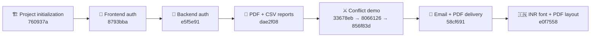
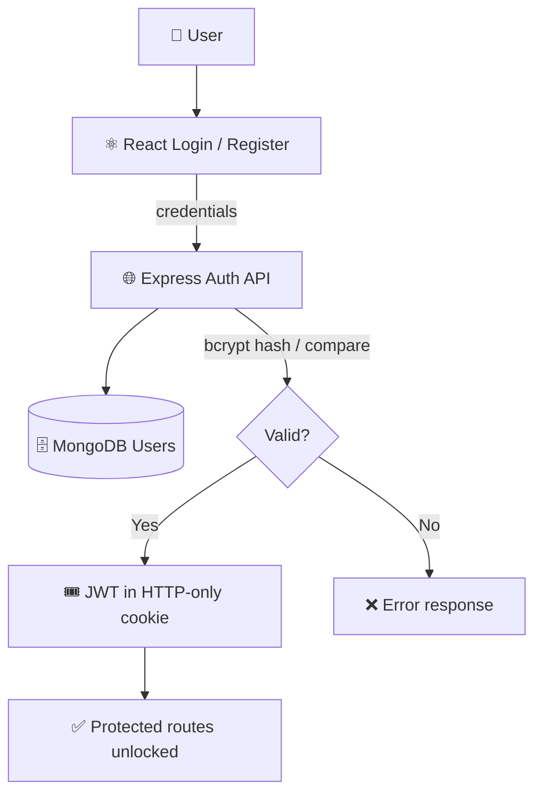
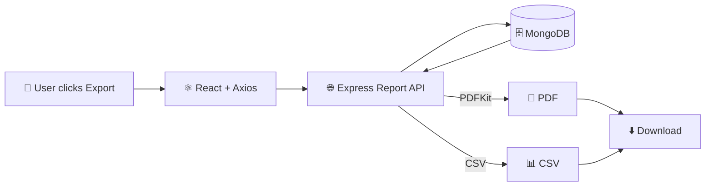
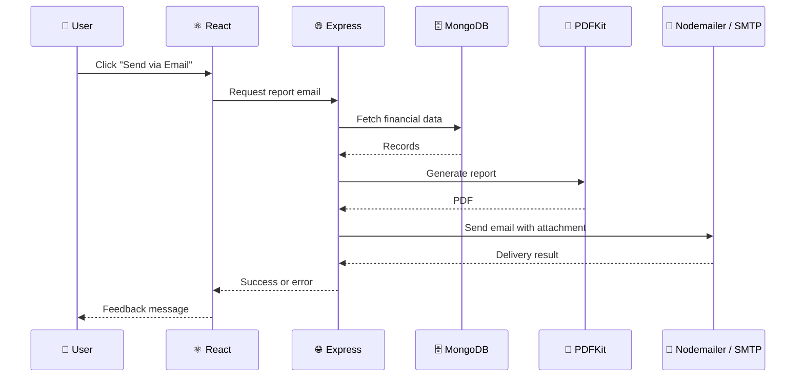
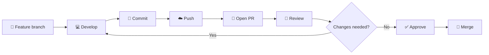
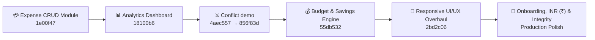
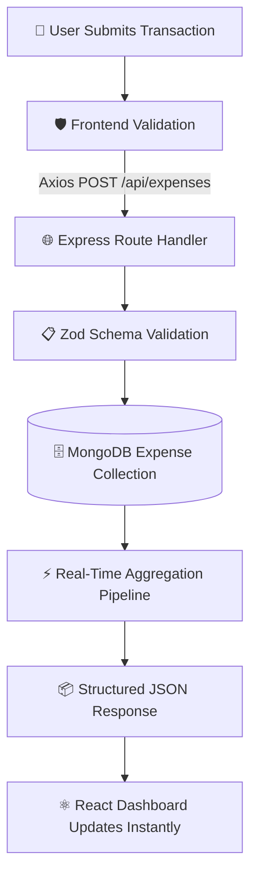
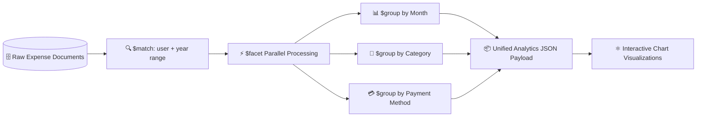
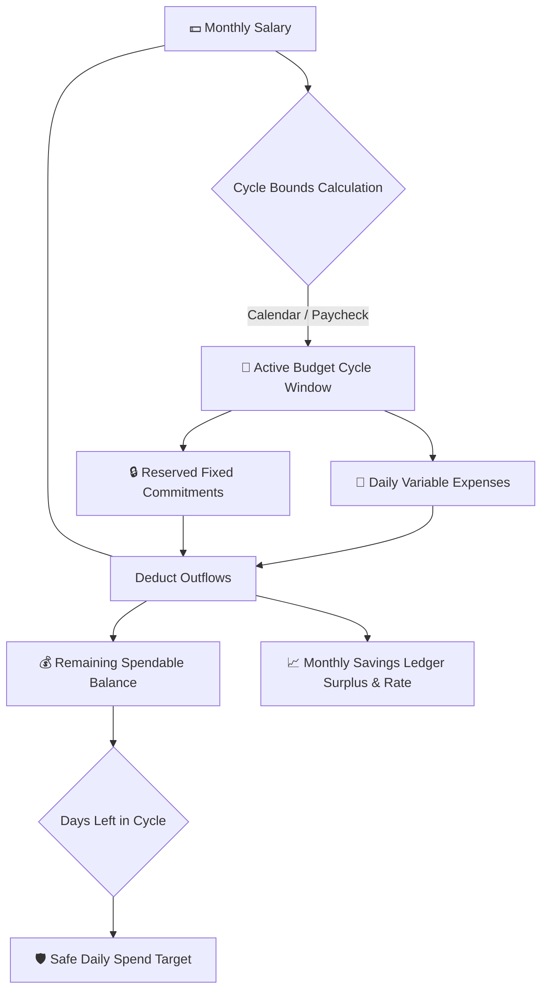

<div align="center">

# ✨ FINORA
## 🌟 Team Contribution Records & Collaborative Development Log
### _Personal Finance & Expense Management System_

_Advanced Tools and Applications · MCA · SEC101 · Project Development Using Git, GitHub and Markdown_

[](https://react.dev/)
[](https://nodejs.org/)
[](https://www.mongodb.com/)
[](https://git-scm.com/)

---

### 👥 Project Contributors

| Contributor | GitHub Handle | Key Responsibilities | Total Commits | Pull Requests |
| :--- | :--- | :--- | :---: | :---: |
| **👩‍💻 Divya Shakti** | [`@DivyaShaktiCodingWorld`](https://github.com/DivyaShaktiCodingWorld) | Authentication, Security, PDF/CSV Reports, INR Font & Email Notifications | **13** _(8 authored + 5 merge)_ | **4 Merged** (`#1`, `#3`, `#6`, `#8`) |
| **👨‍💻 Vishal Singhaniya** | [`@singhaniya0411`](https://github.com/singhaniya0411) | Expense Management (CRUD), Analytics & Charts, Budget & Monthly Savings Engine, Modern UI/UX | **9** _(5 authored + 4 merge)_ | **4 Merged** (`#2`, `#4`, `#5`, `#7`) |

</div>

---

## 📑 Master Table of Contents

- [✨ FINORA](#-finora)
  - [🌟 Team Contribution Records \& Collaborative Development Log](#-team-contribution-records--collaborative-development-log)
    - [👥 Project Contributors](#-project-contributors)
  - [📑 Master Table of Contents](#-master-table-of-contents)
- [==================================================](#==================================================)
- [PART 1: CONTRIBUTION RECORD — DIVYA SHAKTI](#part-1-contribution-record--divya-shakti)
- [==================================================](#==================================================-1)
  - [💎 1. Project \& Role](#-1-project--role)
  - [🏆 2. Contributions at a Glance](#-2-contributions-at-a-glance)
    - [📊 Summary](#-summary)
    - [🗺️ Development Journey](#️-development-journey)
  - [🏗️ 3. Project Initialization](#️-3-project-initialization)
  - [🔐 4. Authentication \& Security](#-4-authentication--security)
    - [🎯 Objective](#-objective)
    - [⚙️ Implementation](#️-implementation)
    - [🔄 Authentication Flow](#-authentication-flow)
    - [⭐ Value Added](#-value-added)
    - [🧰 Technologies](#-technologies)
    - [📚 Learning Outcomes](#-learning-outcomes)
  - [📄 5. PDF Reports, CSV Export \& INR Support](#-5-pdf-reports-csv-export--inr-support)
    - [5.1 PDF Report Generation \& CSV Export](#51-pdf-report-generation--csv-export)
    - [5.2 🇮🇳 INR (₹) Font Support \& PDF Layout Refinement](#52--inr--font-support--pdf-layout-refinement)
  - [📧 6. Email Notifications \& PDF Delivery](#-6-email-notifications--pdf-delivery)
    - [🎯 Objective](#-objective-1)
    - [⚙️ Implementation](#️-implementation-1)
    - [🔔 Notification Flow](#-notification-flow)
    - [📎 PDF-by-Email Flow](#-pdf-by-email-flow)
    - [🔒 Security Considerations](#-security-considerations)
    - [🧰 Technologies](#-technologies-1)
    - [📚 Learning Outcomes](#-learning-outcomes-1)
  - [🌿 7. Branches](#-7-branches)
  - [🔀 8. Pull Requests](#-8-pull-requests)
  - [🧐 9. Code Review Participation](#-9-code-review-participation)
    - [✅ Review Checklist](#-review-checklist)
    - [💬 Benefits Gained](#-benefits-gained)
    - [🗂️ Review Evidence](#️-review-evidence)
  - [⚔️ 10. Merge Conflict Demonstration \& Resolution](#️-10-merge-conflict-demonstration--resolution)
    - [🧾 Conflict-Related Commits](#-conflict-related-commits)
    - [🪜 Steps Followed](#-steps-followed)
    - [🧩 Conflict Markers](#-conflict-markers)
    - [🛠️ Resolution Commands](#️-resolution-commands)
  - [🔒 11. Secure Development Practices](#-11-secure-development-practices)
  - [📈 12. Verified Commit History](#-12-verified-commit-history)
    - [🧾 Authored Commits](#-authored-commits)
    - [🔗 Merge Commits](#-merge-commits)
  - [💎 13. Overall Impact](#-13-overall-impact)
    - [🌟 Three Major Areas](#-three-major-areas)
  - [🎓 14. Skills \& Learning Outcomes](#-14-skills--learning-outcomes)
  - [🏆 15. Final Statement \& References](#-15-final-statement--references)
    - [🔗 References](#-references)
- [==================================================](#==================================================-2)
- [PART 2: CONTRIBUTION RECORD — VISHAL SINGHANIYA](#part-2-contribution-record--vishal-singhaniya)
- [==================================================](#==================================================-3)
  - [💎 1. Project \& Role (Vishal Singhaniya)](#-1-project--role-vishal-singhaniya)
  - [🏆 2. Contributions at a Glance (Vishal Singhaniya)](#-2-contributions-at-a-glance-vishal-singhaniya)
    - [📊 Summary](#-summary-1)
    - [🗺️ Development Journey](#️-development-journey-1)
  - [💳 3. Expense Management Module (Full CRUD \& Dynamic Filtering)](#-3-expense-management-module-full-crud--dynamic-filtering)
    - [🎯 Objective](#-objective-2)
    - [⚙️ Technical Implementation](#️-technical-implementation)
    - [🔄 Expense Processing Lifecycle](#-expense-processing-lifecycle)
    - [⭐ Value Added](#-value-added-1)
    - [🧰 Technologies](#-technologies-2)
    - [📚 Learning Outcomes](#-learning-outcomes-2)
  - [📊 4. Financial Analytics Engine \& Interactive Visualizations](#-4-financial-analytics-engine--interactive-visualizations)
    - [🎯 Objective](#-objective-3)
    - [⚙️ Technical Implementation](#️-technical-implementation-1)
    - [🔄 Analytics Aggregation Pipeline](#-analytics-aggregation-pipeline)
    - [⭐ Value Added](#-value-added-2)
    - [🧰 Technologies](#-technologies-3)
    - [📚 Learning Outcomes](#-learning-outcomes-3)
  - [💰 5. Budget Management, Cash Reserves \& Monthly Savings Tracker Engine](#-5-budget-management-cash-reserves--monthly-savings-tracker-engine)
    - [5.1 Dynamic Budget Cycle \& Spendable Balance Engine](#51-dynamic-budget-cycle--spendable-balance-engine)
    - [5.2 Month-by-Month Savings Ledger \& Pre-Membership Integrity](#52-month-by-month-savings-ledger--pre-membership-integrity)
    - [5.3 On-Demand Future Months Planning Engine](#53-on-demand-future-months-planning-engine)
    - [🔄 Budget \& Savings Flowchart](#-budget--savings-flowchart)
    - [⭐ Value Added](#-value-added-3)
    - [🧰 Technologies](#-technologies-4)
    - [📚 Learning Outcomes](#-learning-outcomes-4)
  - [🎨 6. UI/UX Modernization, Left Navbar, Responsive Layout \& Onboarding](#-6-uiux-modernization-left-navbar-responsive-layout--onboarding)
    - [6.1 Ergonomic Left-Side Navbar \& Responsive Drawer Layout](#61-ergonomic-left-side-navbar--responsive-drawer-layout)
    - [6.2 First-Time User Onboarding Salary \& EMI Setup Modal](#62-first-time-user-onboarding-salary--emi-setup-modal)
    - [6.3 Fixed Dues Checklist: State-Transition Protection, Strikethrough \& Chart Synchronization](#63-fixed-dues-checklist-state-transition-protection-strikethrough--chart-synchronization)
    - [6.4 Legal Compliance Pages \& Modern Footer](#64-legal-compliance-pages--modern-footer)
    - [⭐ Value Added](#-value-added-4)
    - [🧰 Technologies](#-technologies-5)
    - [📚 Learning Outcomes](#-learning-outcomes-5)
  - [🌿 7. Branches (Vishal Singhaniya)](#-7-branches-vishal-singhaniya)
  - [🔀 8. Pull Requests (Vishal Singhaniya)](#-8-pull-requests-vishal-singhaniya)
  - [🧐 9. Code Review Participation (Vishal Singhaniya)](#-9-code-review-participation-vishal-singhaniya)
    - [✅ Review Methodology \& Verification Areas](#-review-methodology--verification-areas)
    - [🗂️ Peer Review Evidence](#️-peer-review-evidence)
  - [⚔️ 10. Merge Conflict Demonstration \& Resolution (Vishal Singhaniya)](#️-10-merge-conflict-demonstration--resolution-vishal-singhaniya)
    - [🧾 Competing Edit Commit](#-competing-edit-commit)
    - [🪜 Resolution Workflow](#-resolution-workflow)
  - [🔒 11. Secure Development Practices (Vishal Singhaniya)](#-11-secure-development-practices-vishal-singhaniya)
  - [📈 12. Verified Commit History (Vishal Singhaniya)](#-12-verified-commit-history-vishal-singhaniya)
    - [🧾 Authored Commits](#-authored-commits-1)
    - [🔗 Merge Commits](#-merge-commits-1)
  - [💎 13. Overall Impact (Vishal Singhaniya)](#-13-overall-impact-vishal-singhaniya)
    - [🌟 Core Impact Pillars](#-core-impact-pillars)
  - [🎓 14. Skills \& Learning Outcomes (Vishal Singhaniya)](#-14-skills--learning-outcomes-vishal-singhaniya)
  - [🏆 15. Final Statement \& References (Vishal Singhaniya)](#-15-final-statement--references-vishal-singhaniya)
    - [🔗 References](#-references-1)
- [==================================================](#==================================================-4)
- [PART 3: JOINT PROJECT CONCLUSION \& HEALTH](#part-3-joint-project-conclusion--health)
- [==================================================](#==================================================-5)

---

# ==================================================
# PART 1: CONTRIBUTION RECORD — DIVYA SHAKTI
# ==================================================

<div align="center">

### 👩‍💻 Divya Shakti · [`@DivyaShaktiCodingWorld`](https://github.com/DivyaShaktiCodingWorld)
**Authentication · Financial Reporting · Email Delivery · Unicode Fonts**

</div>

---

## 💎 1. Project & Role

|                 |                                                                                   |
| --------------- | --------------------------------------------------------------------------------- |
| **Project**     | Finora – Personal Finance & Expense Management System                             |
| **Subject**     | Advanced Tools and Applications                                                   |
| **Assignment**  | Project Development Using Git, GitHub and Markdown                                |
| **Contributor** | Divya Shakti                                                                      |
| **Repository**  | [DivyaShaktiCodingWorld/Finora](https://github.com/DivyaShaktiCodingWorld/Finora) |
| **Stack**       | React.js · Node.js · Express.js · MongoDB · Mongoose                              |

**About Finora:** a full-stack web application that helps users organize their finances, track expenses and access financial information securely from one place.

**Focus areas:** secure access, financial reporting, email communication and a clean, traceable Git workflow.

---

## 🏆 2. Contributions at a Glance

|     | Contribution                                     | Branch                                                        |                         Pull Request                          |
| :-: | ------------------------------------------------ | ------------------------------------------------------------- | :-----------------------------------------------------------: |
| 🏗️  | **Project initialization**                       | `main`                                                        |                               —                               |
| 🔐  | **Authentication & security**                    | `feature-Authentication-DivyaShakti`                          | [#1](https://github.com/DivyaShaktiCodingWorld/Finora/pull/1) |
| 📄  | **PDF reports & CSV export**                     | `feature-reportsgeneration-divyashakti`                       | [#3](https://github.com/DivyaShaktiCodingWorld/Finora/pull/3) |
| 📧  | **Email notifications & PDF delivery**           | `feature-email-notifications-divyashakti`                     | [#6](https://github.com/DivyaShaktiCodingWorld/Finora/pull/6) |
| 🇮🇳  | **INR (₹) font support & PDF layout refinement** | `feature-expense-reports-generation-improvements-divyashakti` | [#8](https://github.com/DivyaShaktiCodingWorld/Finora/pull/8) |
| ⚔️  | **Merge conflict resolution**                    | `feature-mergeconflict-divyashakti`                           |                               —                               |
| 🔒  | **Secure configuration practices**               | All branches                                                  |                               —                               |

### 📊 Summary

|           🧾 Commits            | 🌿 Branches |   🔀 Pull Requests   | ⚔️ Conflicts Resolved |
| :-----------------------------: | :---------: | :------------------: | :-------------------: |
| **13** _(8 authored + 5 merge)_ |    **5**    | **4** _(all merged)_ |         **1**         |

### 🗺️ Development Journey



---

## 🏗️ 3. Project Initialization

**Commit:** `760937a` — _Initialize Finora project structure_

Established the repository starting point on which all later features were built.

- Base project structure created
- Repository prepared for feature-branch development
- Foundation laid for authentication, reporting and email features

---

## 🔐 4. Authentication & Security

> **Branch:** `feature-Authentication-DivyaShakti` _(head of PR #1: `Authentication-DivyaShakti`)_ · **PR:** [#1](https://github.com/DivyaShaktiCodingWorld/Finora/pull/1) · **Commits:** `8793bba`, `e5f5e91` · **Merge:** `6b02728`

### 🎯 Objective

Provide secure account access so that private financial data stays protected.

### ⚙️ Implementation

| Layer                | Work done                                                                                              |
| -------------------- | ------------------------------------------------------------------------------------------------------ |
| **Frontend**         | Registration and login pages in React                                                                  |
| **Backend**          | Authentication REST APIs with Express and Mongoose                                                     |
| **Passwords**        | Hashing with **bcrypt** (cost factor 12)                                                               |
| **Tokens**           | Dual **JWT** architecture: short-lived access tokens and long-lived refresh tokens                     |
| **Cookies**          | Both tokens stored in **HTTP-only cookies**                                                            |
| **Refresh rotation** | Refresh token rotation with SHA-256 hash validation in the database                                    |
| **CSRF protection**  | Double-submit CSRF cookie and header validation with timing-safe comparison on state-changing requests |
| **Rate limiting**    | Limits on authentication routes to reduce brute-force attempts                                         |
| **Access control**   | Protected client-side routing for authenticated users                                                  |
| **Session refresh**  | Automatic session renewal through Axios interceptors                                                   |
| **Integration**      | Frontend pages connected to backend APIs                                                               |

### 🔄 Authentication Flow



| Component          | Role                                                             |
| ------------------ | ---------------------------------------------------------------- |
| React pages        | Collect credentials and show feedback                            |
| Express API        | Validates input, hashes and compares passwords, issues the token |
| MongoDB / Mongoose | Stores user records                                              |
| bcrypt             | Stores password hashes only, never plain text                    |
| JWT                | Proves identity on later requests                                |
| HTTP-only cookie   | Keeps the token away from client-side JavaScript                 |

### ⭐ Value Added

Foundation for secure account access, password protection and user-specific financial data.

### 🧰 Technologies

`React.js` · `JavaScript` · `Node.js` · `Express.js` · `MongoDB` · `Mongoose` · `bcrypt` · `JWT` · `HTTP-only cookies`

### 📚 Learning Outcomes

Frontend and backend authentication integration · REST API design · JWT concepts · bcrypt hashing · HTTP-only cookies · Mongoose modelling · application security fundamentals

---

## 📄 5. PDF Reports, CSV Export & INR Support

### 5.1 PDF Report Generation & CSV Export

> **Branch:** `feature-reportsgeneration-divyashakti` · **PR:** [#3](https://github.com/DivyaShaktiCodingWorld/Finora/pull/3) · **Commit:** `dae2f08` · **Merge:** `ea7e345`

**Objective:** Let users take their financial information out of the application in useful formats.

**Implementation**

- **One-click download** from the dashboard (`Download PDF` / `Download CSV`) with loading states
- Reports follow the **active view**: time period, category filter, search text and sort order
- **PDF report** (branded, multi-page, page numbers on every page): header with account details and applied filters, **8 summary cards** (Total Spent, Transactions, Avg per Transaction, Daily Average, Highest Expense, Lowest Expense, Top Category, Peak Spending Day), category breakdown, payment method breakdown, monthly breakdown, top expenses and a transaction details table
- **CSV report** with report information, summary metrics, breakdowns and full transactions in one file, a UTF-8 BOM for correct characters in Excel and Google Sheets, and **CSV injection protection** (cells starting with `=`, `+`, `-` or `@` are escaped)
- Smart file names, for example `finora-expenses_2026-11-01_to_2026-11-30.pdf`
- **Validation and limits:** Zod validation for dates, category, search and sort; a maximum of 10,000 transactions per report; reports generated only from the logged-in user's own data
- Amounts calculated in cents internally to avoid floating-point errors



| 📄 PDF                   | 📊 CSV                             |
| ------------------------ | ---------------------------------- |
| Readable document        | Plain tabular data                 |
| Easy to save and share   | Easy to analyse                    |
| Structured presentation  | Opens in Excel and Google Sheets   |
| Financial record keeping | Filtering and further calculations |

**Technologies:** `PDFKit` · `Node.js` · `Express.js` · `React.js` · `Axios` · `MongoDB`

**Learning outcomes:** File generation in Node.js · PDFKit · CSV export · organizing financial data · downloadable file handling

### 5.2 🇮🇳 INR (₹) Font Support & PDF Layout Refinement

> **Branch:** `feature-expense-reports-generation-improvements-divyashakti` · **PR:** [#8](https://github.com/DivyaShaktiCodingWorld/Finora/pull/8) · **Commit:** `e0f7558` — _Fix INR currency rendering and improve PDF report layout_ · **Merge:** `ec64eef`

**Problem:** PDFKit's built-in Helvetica fonts cannot display the Indian Rupee symbol (₹), so currency values in generated reports did not render correctly.

**Solution**

| Area              | Work done                                                                                                                            |
| ----------------- | ------------------------------------------------------------------------------------------------------------------------------------ |
| **Fonts**         | Added `NotoSans-Regular.ttf` and `NotoSans-Bold.ttf` (Unicode-compatible)                                                            |
| **Registration**  | Custom fonts registered with PDFKit                                                                                                  |
| **Replacement**   | Built-in Helvetica fonts replaced throughout the report                                                                              |
| **INR rendering** | ₹ renders in summary cards, total spending, category and payment breakdowns, monthly summaries, top expenses and transaction details |
| **Layout**        | Improved summary card dimensions and spacing, more room between elements, more consistent typography                                 |
| **Safety**        | Report calculations, filters and the generation workflow left unchanged                                                              |

| File                                           | Change                                                             |
| ---------------------------------------------- | ------------------------------------------------------------------ |
| `server/src/utils/pdfReport.js`                | Unicode font registration, font replacement and layout refinements |
| `server/src/assets/fonts/NotoSans-Regular.ttf` | Regular Unicode font added                                         |
| `server/src/assets/fonts/NotoSans-Bold.ttf`    | Bold Unicode font added                                            |

**Value added:** Finora serves Indian users, so correct ₹ display and readable reports are essential. The email feature reuses the same PDF generator, so PDFs sent by email benefit as well.

**Verification checklist**

- [x] Generate a fresh PDF expense report
- [x] ₹ symbol renders correctly
- [x] Regular and bold text render correctly
- [x] Summary card spacing and readability are good
- [x] Calculations and filters are unchanged

**Learning outcomes:** Unicode font handling in PDFKit · custom font registration · PDF layout and typography · making a targeted change without breaking existing behaviour

---

## 📧 6. Email Notifications & PDF Delivery

> **Branch:** `feature-email-notifications-divyashakti` · **PR:** [#6](https://github.com/DivyaShaktiCodingWorld/Finora/pull/6) · **Commit:** `58cf691` · **Merge:** `2d3961c`

### 🎯 Objective

Let users receive financial notifications and PDF reports in their inbox without opening the application.

### ⚙️ Implementation

- Reusable backend email service using **Nodemailer**
- **SMTP** configuration (Gmail SMTP) through **environment variables**
- Structured **HTML email** content
- Notifications for configured financial activities, including budget-related ones
- **Send via Email**: generates the PDF report and attaches it to the email
- Frontend email actions connected to the backend, with an integrated **Send via Email** option in the Report Export section
- Recipient resolved from the verified, authenticated user session, which prevents spoofed or unauthorized relays
- Endpoint: `POST /api/reports/email` (requires login)
- Operation status and **error handling**, so a failed send is never shown as a success

### 🔔 Notification Flow


### 📎 PDF-by-Email Flow



### 🔒 Security Considerations

- SMTP credentials kept in backend environment variables
- No private credentials in frontend code
- Real `.env` files excluded from the repository
- Email failures reported honestly

### 🧰 Technologies

`Nodemailer` · `Gmail SMTP` · `PDFKit` · `Node.js` · `Express.js` · `React.js` · `Environment variables`

### 📚 Learning Outcomes

Nodemailer · SMTP configuration · HTML email · attachment handling · PDF and email integration · environment-based configuration · backend error handling

---

## 🌿 7. Branches

|  #  | Branch                                                        | Responsibility                             | Commits                         |                         Pull Request                          |
| :-: | ------------------------------------------------------------- | ------------------------------------------ | ------------------------------- | :-----------------------------------------------------------: |
|  1  | `feature-Authentication-DivyaShakti`                          | Authentication and security                | `760937a`, `8793bba`, `e5f5e91` | [#1](https://github.com/DivyaShaktiCodingWorld/Finora/pull/1) |
|  2  | `feature-reportsgeneration-divyashakti`                       | PDF and CSV report generation              | `dae2f08`                       | [#3](https://github.com/DivyaShaktiCodingWorld/Finora/pull/3) |
|  3  | `feature-mergeconflict-divyashakti`                           | Merge conflict demonstration               | `33678eb`, `8066126`            |                  resolved by merge `856f83d`                  |
|  4  | `feature-email-notifications-divyashakti`                     | Email notifications and PDF delivery       | `58cf691`                       | [#6](https://github.com/DivyaShaktiCodingWorld/Finora/pull/6) |
|  5  | `feature-expense-reports-generation-improvements-divyashakti` | INR font support and PDF layout refinement | `e0f7558`                       | [#8](https://github.com/DivyaShaktiCodingWorld/Finora/pull/8) |

> The repository also contains `feature-vishal`, `feature-vishal-analytics`, `feature-budget-savings-vishal`, `feature-mergeConflict-vishal` and `improve-ui-fix`, which belong to the other contributor (Vishal Singhaniya).

**Branching rules followed**

1. No direct commits to `main`
2. One feature per branch, named `feature-<topic>-divyashakti`
3. Meaningful commit messages
4. Integration into `main` only through a Pull Request

**Git commands used**

```bash
git branch                                              # list branches
git switch -c feature-email-notifications-divyashakti   # create a feature branch
git status                                              # check changes
git add .                                               # stage changes
git commit -m "Implement email notifications and PDF report delivery"
git push -u origin feature-email-notifications-divyashakti
git log --oneline --graph --all                         # inspect history
```

---

## 🔀 8. Pull Requests

| PR                                                            | Feature                                  | Branch → Target                                                        | Status                |
| ------------------------------------------------------------- | ---------------------------------------- | ---------------------------------------------------------------------- | --------------------- |
| [#1](https://github.com/DivyaShaktiCodingWorld/Finora/pull/1) | Authentication                           | `Authentication-DivyaShakti` → `main`                                  | ✅ Merged (`6b02728`) |
| [#3](https://github.com/DivyaShaktiCodingWorld/Finora/pull/3) | PDF and CSV Report Generation            | `feature-reportsgeneration-divyashakti` → `main`                       | ✅ Merged (`ea7e345`) |
| [#6](https://github.com/DivyaShaktiCodingWorld/Finora/pull/6) | Email Notifications and PDF Delivery     | `feature-email-notifications-divyashakti` → `main`                     | ✅ Merged (`2d3961c`) |
| [#8](https://github.com/DivyaShaktiCodingWorld/Finora/pull/8) | INR Font Support & PDF Layout Refinement | `feature-expense-reports-generation-improvements-divyashakti` → `main` | ✅ Merged (`ec64eef`) |

**Pull Requests by the other contributor reviewed and integrated:** [#2](https://github.com/DivyaShaktiCodingWorld/Finora/pull/2) expense management (CRUD), [#4](https://github.com/DivyaShaktiCodingWorld/Finora/pull/4) analytics dashboard, [#5](https://github.com/DivyaShaktiCodingWorld/Finora/pull/5) budget and savings tracker, [#7](https://github.com/DivyaShaktiCodingWorld/Finora/pull/7) user experience improvements.

**Pull Request practice**

- Correct target branch selected
- Clear title and description written
- Review requested from the other contributor
- Changed files examined
- Review feedback addressed
- Feature integrated after approval



---

## 🧐 9. Code Review Participation

Participation covered both roles: author (Pull Requests reviewed by the other contributor) and reviewer (teammate changes examined before integration).

### ✅ Review Checklist

| Area                | Question                                          |
| ------------------- | ------------------------------------------------- |
| **Readability**     | Is the code clear and organized?                  |
| **Functionality**   | Does it meet the feature requirement?             |
| **Security**        | Are secrets and sensitive data handled safely?    |
| **Error handling**  | Are failures and invalid inputs handled?          |
| **API integration** | Do frontend and backend agree on routes and data? |
| **Documentation**   | Is the work explained clearly?                    |

### 💬 Benefits Gained

Improved readability, earlier issue detection, shared technical knowledge and clearer communication between contributors.

### 🗂️ Review Evidence

> Git history records commits and merges, but not review comments or approvals. These are found on GitHub in each Pull Request's **Conversation** and **Files changed** tabs.

| Pull Request                                                                                                                                                                                                                                               | Role     | Where to find the review            |
| ---------------------------------------------------------------------------------------------------------------------------------------------------------------------------------------------------------------------------------------------------------- | -------- | ----------------------------------- |
| [#1 Authentication](https://github.com/DivyaShaktiCodingWorld/Finora/pull/1)                                                                                                                                                                               | Author   | Conversation and Files changed tabs |
| [#3 PDF & CSV Reports](https://github.com/DivyaShaktiCodingWorld/Finora/pull/3)                                                                                                                                                                            | Author   | Conversation and Files changed tabs |
| [#6 Email Notifications](https://github.com/DivyaShaktiCodingWorld/Finora/pull/6)                                                                                                                                                                          | Author   | Conversation and Files changed tabs |
| [#8 INR Font & PDF Layout](https://github.com/DivyaShaktiCodingWorld/Finora/pull/8)                                                                                                                                                                        | Author   | Conversation and Files changed tabs |
| [#2](https://github.com/DivyaShaktiCodingWorld/Finora/pull/2), [#4](https://github.com/DivyaShaktiCodingWorld/Finora/pull/4), [#5](https://github.com/DivyaShaktiCodingWorld/Finora/pull/5), [#7](https://github.com/DivyaShaktiCodingWorld/Finora/pull/7) | Reviewer | Conversation and Files changed tabs |

---

## ⚔️ 10. Merge Conflict Demonstration & Resolution

**Goal:** Understand and resolve a real conflict that occurs when two developers edit the same line of the same file.

**Shared file:** `merge-conflict-demo.txt` · **Branches:** `feature-mergeconflict-divyashakti` and `feature-mergeConflict-vishal`

### 🧾 Conflict-Related Commits

| Hash      | Message                                                     | Activity                              |
| --------- | ----------------------------------------------------------- | ------------------------------------- |
| `33678eb` | Add merge-conflict-demo.txt for merge conflict task         | Demo file created                     |
| `8066126` | Update status line in merge-conflict-demo.txt (DivyaShakti) | Independent edit made                 |
| `856f83d` | Resolve merge conflict in merge-conflict-demo.txt           | Conflict resolved and merge committed |

_The other contributor made a competing edit to the same line (`4aec557`), which produced the conflict._

### 🪜 Steps Followed

1. Created the shared demo file
2. Made an independent edit
3. Merged the competing edit and encountered the conflict
4. Located the conflicting section
5. Compared both versions
6. Wrote the correct final content and removed the markers
7. Committed the resolution
8. Verified the history

### 🧩 Conflict Markers

```text
<<<<<<< HEAD
Content from the current branch
=======
Content from the incoming branch
>>>>>>> other-branch
```

### 🛠️ Resolution Commands

```bash
git status                                   # find conflicted files
# edit the file, keep the intended text, delete the markers
git add merge-conflict-demo.txt              # mark as resolved
git commit -m "Resolve merge conflict in merge-conflict-demo.txt"
git log --oneline --graph --all              # verify
```

**Takeaway:** Read both versions, decide the correct final content, remove the markers, then commit.

---

## 🔒 11. Secure Development Practices

> **🔐 Rule:** SMTP app passwords, MongoDB credentials, JWT secrets and private API keys must never be committed to a public repository.

| Practice                                   | Applies to                           |
| ------------------------------------------ | ------------------------------------ |
| Secrets in environment variables           | SMTP, database and JWT configuration |
| No credentials in frontend code            | Email and API configuration          |
| Passwords stored as bcrypt hashes          | Authentication                       |
| Tokens in HTTP-only cookies                | Authentication                       |
| Honest error handling                      | Email delivery                       |
| `.gitignore` for local and sensitive files | Whole repository                     |

| File           | Purpose                                  |
| -------------- | ---------------------------------------- |
| `.env`         | Local secrets, never committed           |
| `.env.example` | Safe template with placeholder values    |
| `.gitignore`   | Excludes sensitive and unnecessary files |

---

## 📈 12. Verified Commit History

Total commits: **13**, verified from the repository history: **8 authored commits** and **5 merge commits**.

### 🧾 Authored Commits

|   # | Hash      | Message                                                     | Area             |
| --: | --------- | ----------------------------------------------------------- | ---------------- |
|   1 | `760937a` | Initialize Finora project structure                         | Project setup    |
|   2 | `8793bba` | Build Finora Frontend Authentication Pages                  | Frontend auth    |
|   3 | `e5f5e91` | Implement backend authentication APIs                       | Backend auth     |
|   4 | `dae2f08` | Implement PDF and CSV expense report generation             | Reporting        |
|   5 | `33678eb` | Add merge-conflict-demo.txt for merge conflict task         | Conflict demo    |
|   6 | `8066126` | Update status line in merge-conflict-demo.txt (DivyaShakti) | Conflict demo    |
|   7 | `58cf691` | Implement email notifications and PDF report delivery       | Email            |
|   8 | `e0f7558` | Fix INR currency rendering and improve PDF report layout    | INR / PDF layout |

### 🔗 Merge Commits

|   # | Hash      | Message                                                                                                       | Purpose                            |
| --: | --------- | ------------------------------------------------------------------------------------------------------------- | ---------------------------------- |
|   9 | `6b02728` | Merge pull request #1 from DivyaShaktiCodingWorld/Authentication-DivyaShakti                                  | Integrated authentication          |
|  10 | `ea7e345` | Merge pull request #3 from DivyaShaktiCodingWorld/feature-reportsgeneration-divyashakti                       | Integrated PDF and CSV reports     |
|  11 | `856f83d` | Resolve merge conflict in merge-conflict-demo.txt                                                             | Conflict resolution                |
|  12 | `2d3961c` | Merge pull request #6 from DivyaShaktiCodingWorld/feature-email-notifications-divyashakti                     | Integrated email delivery          |
|  13 | `ec64eef` | Merge pull request #8 from DivyaShaktiCodingWorld/feature-expense-reports-generation-improvements-divyashakti | Integrated INR font and PDF layout |

---

## 💎 13. Overall Impact

| Contribution                        | Value added to Finora                       |
| ----------------------------------- | ------------------------------------------- |
| Project initialization              | Foundation for all development              |
| Frontend authentication             | User-facing login and registration          |
| Backend authentication APIs         | Server-side secure access                   |
| bcrypt, JWT and cookies             | Password and session security               |
| PDF report generation               | Financial data as a shareable document      |
| INR font support (Noto Sans)        | Correct ₹ display and more readable reports |
| CSV export                          | Portable, spreadsheet-ready data            |
| Email notifications                 | Communication beyond the interface          |
| PDF email delivery                  | Reports delivered to the inbox              |
| Branches, commits and Pull Requests | Traceable, organized development            |
| Conflict resolution                 | Healthy collaboration on shared files       |
| Secure configuration                | Safer handling of credentials               |

### 🌟 Three Major Areas

<details>
<summary><strong>🔐 Security & Access</strong></summary>

Authentication controls access to the application and protects user-specific financial information.

</details>

<details>
<summary><strong>📊 Financial Information Accessibility</strong></summary>

PDF and CSV exports, with correct ₹ rendering, let users access, keep and process their own financial data.

</details>

<details>
<summary><strong>📧 Communication & Collaboration</strong></summary>

Email integration extends the application beyond its interface, and Git and GitHub practices kept teamwork structured and traceable.

</details>

---

## 🎓 14. Skills & Learning Outcomes

| Area                | Skills                                                                                  |
| ------------------- | --------------------------------------------------------------------------------------- |
| 💻 **Full-stack**   | React, Node.js, Express, REST APIs, MongoDB, Mongoose, frontend-backend integration     |
| 🔐 **Security**     | JWT, bcrypt, protected routes, HTTP-only cookies, environment variables                 |
| 📄 **Reporting**    | PDFKit, CSV export, Unicode fonts, downloadable files, data organization                |
| 📧 **Email**        | Nodemailer, SMTP, HTML email, attachments, error handling                               |
| 🌿 **Git & GitHub** | Branching, commits, Pull Requests, code review, history inspection, conflict resolution |
| 🤝 **Professional** | Feature ownership, documentation, debugging, teamwork                                   |

> 💡 **Key takeaway:** Software development is more than writing code. It also involves planning, securing, tracking changes, collaborating, resolving integration problems and documenting the work.

---

## 🏆 15. Final Statement & References

Divya Shakti developed and integrated authentication, financial reporting and email features for Finora, from project setup through to secure, usable functionality. The work includes the frontend and backend of the authentication system, PDF and CSV report generation, email notifications with PDF delivery through Nodemailer and SMTP, and Unicode Noto Sans font support for correct ₹ rendering in reports.

The development followed a structured Git and GitHub workflow: feature branches, meaningful commits, Pull Requests, code review participation and a real merge-conflict resolution.

**These contributions strengthened Finora's security, financial reporting and communication capabilities while applying professional Git and GitHub practices throughout.**

### 🔗 References

- 🌐 [Finora Repository](https://github.com/DivyaShaktiCodingWorld/Finora)
- 🔀 [PR #1 – Authentication](https://github.com/DivyaShaktiCodingWorld/Finora/pull/1)
- 🔀 [PR #3 – PDF and CSV Report Generation](https://github.com/DivyaShaktiCodingWorld/Finora/pull/3)
- 🔀 [PR #6 – Email Notifications and PDF Report Delivery](https://github.com/DivyaShaktiCodingWorld/Finora/pull/6)
- 🔀 [PR #8 – INR Font Support & PDF Layout Refinement](https://github.com/DivyaShaktiCodingWorld/Finora/pull/8)
- 👩‍💻 [GitHub Profile](https://github.com/DivyaShaktiCodingWorld)

---

# ==================================================
# PART 2: CONTRIBUTION RECORD — VISHAL SINGHANIYA
# ==================================================

<div align="center">

### 👨‍💻 Vishal Singhaniya · [`@singhaniya0411`](https://github.com/singhaniya0411)
**Expense Management · Financial Analytics · Budget & Savings Tracker · Responsive UI/UX**


-orange?style=for-the-badge)

</div>

---

## 💎 1. Project & Role (Vishal Singhaniya)

|                 |                                                                                   |
| --------------- | --------------------------------------------------------------------------------- |
| **Project**     | Finora – Personal Finance & Expense Management System                             |
| **Subject**     | Advanced Tools and Applications                                                   |
| **Assignment**  | Project Development Using Git, GitHub and Markdown                                |
| **Contributor** | Vishal Singhaniya                                                                 |
| **GitHub**      | [`@singhaniya0411`](https://github.com/singhaniya0411)                            |
| **Repository**  | [DivyaShaktiCodingWorld/Finora](https://github.com/DivyaShaktiCodingWorld/Finora) |
| **Stack**       | React 19 · Vite · Tailwind CSS v4 · Node.js · Express.js · MongoDB · Mongoose     |

**About My Role in Finora:** Responsible for the complete core financial engine—from daily transaction logging, categorized expense management, and dynamic date-windowing, to high-performance financial analytics visualizations, rolling paycheck and monthly budget calculations, fixed commitments tracking with tenure auto-healing, and modern responsive UI/UX architecture.

**Focus areas:** Core financial CRUD, data visualization & analytics, intelligent budget algorithms, historical wealth accumulation ledgers, responsive accessibility, and rigorous Git collaboration.

---

## 🏆 2. Contributions at a Glance (Vishal Singhaniya)

|     | Contribution                                                  | Branch                          |                          Pull Request                           |
| :-: | ------------------------------------------------------------- | ------------------------------- | :-------------------------------------------------------------: |
| 💳  | **Expense Management (CRUD, Filters & Search)**               | `feature-vishal`                |  [#2](https://github.com/DivyaShaktiCodingWorld/Finora/pull/2)  |
| 📊  | **Financial Analytics Dashboard & Interactive Visualizations** | `feature-vishal-analytics`      |  [#4](https://github.com/DivyaShaktiCodingWorld/Finora/pull/4)  |
| ⚔️  | **Merge Conflict Demonstration & Resolution**                 | `feature-mergeConflict-vishal`  |                   resolved by merge `856f83d`                   |
| 💰  | **Budget Management & Monthly Savings Tracker Engine**        | `feature-budget-savings-vishal` |  [#5](https://github.com/DivyaShaktiCodingWorld/Finora/pull/5)  |
| 🎨  | **UI/UX Modernization, Left Navbar & Onboarding Experience**   | `improve-ui-fix`                |  [#7](https://github.com/DivyaShaktiCodingWorld/Finora/pull/7)  |
| 🇮🇳  | **Universal INR (₹) Standardization & Pre-Membership Savings**| `main`                          |                                —                                |

### 📊 Summary

|           🧾 Commits           | 🌿 Branches |   🔀 Pull Requests   | ⚔️ Conflicts Resolved |
| :----------------------------: | :---------: | :------------------: | :-------------------: |
| **9** _(5 authored + 4 merge)_ |    **5**    | **4** _(all merged)_ |         **1**         |

### 🗺️ Development Journey



---

## 💳 3. Expense Management Module (Full CRUD & Dynamic Filtering)

> **Branch:** `feature-vishal` · **PR:** [#2](https://github.com/DivyaShaktiCodingWorld/Finora/pull/2) · **Commit:** `1e00f47` — _Implement expense management module via CRUD operation-Vishal_ · **Merge:** `fa4eb7a`

### 🎯 Objective

Equip users with a fast, zero-friction transaction management system allowing them to log, organize, inspect, filter, and audit their day-to-day spending with instantaneous feedback.

### ⚙️ Technical Implementation

| Component / Layer | Implementation Details |
| :--- | :--- |
| **Mongoose Data Model** | Designed [`Expense.js`](file:///C:/Users/visin/Downloads/MCA/SEC/assignment1/server/src/models/Expense.js) with strict indexing on `{ user: 1, date: -1 }`, 13 categorized taxonomies, flexible payment methods, and validation. |
| **Backend REST Controller** | Implemented [`expenseController.js`](file:///C:/Users/visin/Downloads/MCA/SEC/assignment1/server/src/controllers/expenseController.js) providing `getExpenses`, `createExpense`, `updateExpense`, `deleteExpense`, and `getExpenseSummary`. |
| **Flexible Date Filtering** | Built dynamic multi-window date filters: `this_month`, `last_month`, `last_3_months`, `this_year`, `all_time`, and custom date ranges. |
| **Live Search & Sort** | Integrated case-insensitive title search with dynamic multi-attribute sorting (`date_desc`, `date_asc`, `amount_desc`, `amount_asc`). |
| **Interactive Modals** | Created [`ExpenseModal.jsx`](file:///C:/Users/visin/Downloads/MCA/SEC/assignment1/client/src/components/expenses/ExpenseModal.jsx) and [`DeleteConfirmModal.jsx`](file:///C:/Users/visin/Downloads/MCA/SEC/assignment1/client/src/components/expenses/DeleteConfirmModal.jsx) with validation and loading states. |
| **Summary Calculation** | Computed real-time metrics: Total Spent, Total Transactions, Average Ticket Size, and Top Category in window. |

### 🔄 Expense Processing Lifecycle



### ⭐ Value Added

Forms the core operational backbone of Finora. Without reliable transaction logging and fast querying, no budgeting, analytics, or export is possible.

### 🧰 Technologies

`React 19` · `Node.js` · `Express.js` · `MongoDB` · `Mongoose` · `Zod Validation` · `Axios` · `Tailwind CSS`

### 📚 Learning Outcomes

Full-stack CRUD architecture · MongoDB compound indexing · dynamic date windowing · Zod schema sanitization · state management for modals and filter bars.

---

## 📊 4. Financial Analytics Engine & Interactive Visualizations

> **Branch:** `feature-vishal-analytics` · **PR:** [#4](https://github.com/DivyaShaktiCodingWorld/Finora/pull/4) · **Commit:** `18100b6` — _Implement expense analytics dashboard with charts_ · **Merge:** `4342ea6`

### 🎯 Objective

Transform raw financial records into actionable intelligence, enabling users to identify behavioral spending patterns, peak expenditure days, and seasonal trends over custom yearly periods.

### ⚙️ Technical Implementation

- **MongoDB Aggregation Pipelines**: Built multi-stage aggregation pipelines in `getExpenseAnalytics` (`expenseController.js`) grouping transactions by month (`$month: "$date"`), category (`$group: { _id: "$category" }`), and payment method.
- **Monthly Stacked Spending Chart ([`MonthlyStackedBarChart.jsx`](file:///C:/Users/visin/Downloads/MCA/SEC/assignment1/client/src/components/analytics/MonthlyStackedBarChart.jsx))**:
  - Displays monthly spending bars across the financial year with interactive tooltips and category breakdowns.
  - Automatically identifies peak spending months and computes month-over-month percentage variances.
- **Category Proportional Pie / Donut Chart ([`CategoryPieChart.jsx`](file:///C:/Users/visin/Downloads/MCA/SEC/assignment1/client/src/components/analytics/CategoryPieChart.jsx))**:
  - Visual breakdown of expenditure distributions across categories with hover interactions, category badges, and dynamic percentages.
- **Top Spending Highlights ([`TopExpenseVisual.jsx`](file:///C:/Users/visin/Downloads/MCA/SEC/assignment1/client/src/components/analytics/TopExpenseVisual.jsx))**:
  - Highlights top individual expenses and largest single spending days to pinpoint budget leakage.
- **Dynamic Year Stepper**:
  - Allows navigation across past financial years with automated availability detection based on user history.

### 🔄 Analytics Aggregation Pipeline



### ⭐ Value Added

Empowers users to answer "Where did my money go?" through clear, visually intuitive visual charts rather than scrolling through hundreds of table rows.

### 🧰 Technologies

`MongoDB Aggregation Framework ($facet, $group, $sort)` · `React 19` · `Tailwind CSS v4` · `SVG Charting` · `Framer Motion`

### 📚 Learning Outcomes

Advanced MongoDB aggregation pipelines · parallel facet execution · accessible data visualization · temporal data grouping · front-end chart rendering without heavy external dependencies.

---

## 💰 5. Budget Management, Cash Reserves & Monthly Savings Tracker Engine

> **Branch:** `feature-budget-savings-vishal` · **PR:** [#5](https://github.com/DivyaShaktiCodingWorld/Finora/pull/5) · **Commit:** `55db532` — _Implement budget management and monthly savings tracker_ · **Merge:** `ac647fd`

### 5.1 Dynamic Budget Cycle & Spendable Balance Engine

- **Dual-Cycle Calculations ([`budgetController.js`](file:///C:/Users/visin/Downloads/MCA/SEC/assignment1/server/src/controllers/budgetController.js))**:
  - **Calendar Month Cycle**: Standard 1st of month to month-end.
  - **Rolling Paycheck Cycle**: Automatically computes rolling cycle bounds based on salary arrival day (e.g. 5th of this month to 4th of next month).
- **Executive Cash Flow Indicators ([`BudgetOverviewCard.jsx`](file:///C:/Users/visin/Downloads/MCA/SEC/assignment1/client/src/components/budget/BudgetOverviewCard.jsx))**:
  - **Total Salary Pool**: Base salary with cycle-specific salary overrides.
  - **Fixed Commitments Pool**: Total reserved funds for recurring bills (Rent, Loan EMIs, Subscriptions).
  - **Remaining Spendable Budget**: `Salary - Fixed Commitments - Variable Daily Spending`.
  - **Safe Daily Spend**: Real-time spending allowance per day based on days remaining in the active cycle.
  - **Budget Health Indicator**: Dynamic status classification (`Healthy Pace`, `75%+ Utilized`, `90%+ Critical`, `Over Budget`).

### 5.2 Month-by-Month Savings Ledger & Pre-Membership Integrity

- **Historical Savings Ledger ([`MonthlySavingsTracker.jsx`](file:///C:/Users/visin/Downloads/MCA/SEC/assignment1/client/src/components/budget/MonthlySavingsTracker.jsx))**:
  - Full audit of monthly salary, fixed dues paid, variable expenses logged, and net cash surplus.
  - Computes monthly savings rate percentage and tracks peak savings month.
- **Pre-Membership Period Protection**:
  - Identifies user join date (`user.createdAt`).
  - Pre-join months (e.g. Jan–Oct for a user joining in Nov) are classified as `isPreJoinMonth: true` with status `not_joined`.
  - Phantom base salary is zeroed out for pre-join months, preventing false 100% savings inflation and ensuring yearly averages remain 100% mathematically authentic.
- **Reverse Chronological Display**:
  - Displays **current month first**, followed by previous months in descending order (e.g., November, October, September... down to January).

### 5.3 On-Demand Future Months Planning Engine

- **Hidden Future Months by Default**:
  - Future months (e.g. December when current is November) are excluded from the ledger unless salary has been explicitly budgeted.
- **Planning Endpoint & Modal**:
  - Built `POST /api/budget/month-salary` in [`budgetRoutes.js`](file:///C:/Users/visin/Downloads/MCA/SEC/assignment1/server/src/routes/budgetRoutes.js).
  - Added **"+ Plan Future Month Salary"** modal allowing users to enter expected income for upcoming months to project future wealth and commitments.

### 🔄 Budget & Savings Flowchart



### ⭐ Value Added

Elevates Finora from a simple retrospective expense logger into a forward-looking proactive financial planning engine that protects users from overspending before month-end.

### 🧰 Technologies

`Node.js` · `Express.js` · `MongoDB & Mongoose Schemas` · `React 19` · `Framer Motion` · `Mathematical Finance Models`

### 📚 Learning Outcomes

Cycle boundary date algorithms · financial health state machines · tenure decrement modeling · temporal join-date isolation · defensive financial calculations avoiding floating point rounding errors.

---

## 🎨 6. UI/UX Modernization, Left Navbar, Responsive Layout & Onboarding

> **Branch:** `improve-ui-fix` · **PR:** [#7](https://github.com/DivyaShaktiCodingWorld/Finora/pull/7) · **Commit:** `2bd2c06` — _Improved User experience and usabilty to new user as well_ · **Merge:** `2e9b2b6`

### 6.1 Ergonomic Left-Side Navbar & Responsive Drawer Layout

- Built [`Sidebar.jsx`](file:///C:/Users/visin/Downloads/MCA/SEC/assignment1/client/src/components/layout/Sidebar.jsx) replacing the legacy top navigation:
  - Persistent left sidebar (`lg:w-72`) with Finora branding and quick `+ Add Expense` launcher.
  - Integrated active route highlighting across Dashboard, Budget, and Analytics.
  - Interactive **Financial Tip** card with dynamic tip cycling directly inside the sidebar.
  - Live **User Account Information** card with verified "Active Session" status badge.
  - Clean one-click logout trigger.
- Implemented [`MainLayout.jsx`](file:///C:/Users/visin/Downloads/MCA/SEC/assignment1/client/src/components/layout/MainLayout.jsx) with desktop fixed view and mobile sliding drawer with backdrop blur.

### 6.2 First-Time User Onboarding Salary & EMI Setup Modal

- Created [`OnboardingSalaryModal.jsx`](file:///C:/Users/visin/Downloads/MCA/SEC/assignment1/client/src/components/budget/OnboardingSalaryModal.jsx):
  - Automatically prompts new users upon signup or first visit to configure their monthly take-home salary.
  - Allows selecting their budget cycle type (*Calendar Month* or *Custom Paycheck Day*).
  - Offers a quick-add section for initial recurring commitments (Rent, Vehicle Loan EMI, Insurance, Subscriptions).
  - Includes a **"Skip for now, I'll do this later"** option that stores a dismissal flag in `localStorage` to avoid intrusive interruptions, complemented by an actionable dashboard banner.

### 6.3 Fixed Dues Checklist: State-Transition Protection, Strikethrough & Chart Synchronization

- **Tenure Inversion & Decrement Fix**:
  - Resolved toggle issue where ticking an EMI incremented remaining installments (+1) instead of decrementing (-1).
  - Added state-transition checks in [`budgetController.js`](file:///C:/Users/visin/Downloads/MCA/SEC/assignment1/server/src/controllers/budgetController.js) ensuring tenure only decrements when transitioning from Unpaid &rarr; Paid, and only increments on Paid &rarr; Unpaid.
  - Built an automatic self-healing check that restores any corrupted tenure back to `totalInstallments` (e.g. restoring 31 back to 30, and then decrementing to 29).
- **Visual Strikethrough Styling**:
  - Implemented `line-through decoration-emerald-600 decoration-2 text-emerald-800 opacity-75` and emerald checkmark badges for paid dues in [`UpcomingDuesWidget.jsx`](file:///C:/Users/visin/Downloads/MCA/SEC/assignment1/client/src/components/budget/UpcomingDuesWidget.jsx) and [`BudgetPage.jsx`](file:///C:/Users/visin/Downloads/MCA/SEC/assignment1/client/src/pages/BudgetPage.jsx).
- **Expense Collection & Chart Synchronization**:
  - Connected fixed commitments with the `Expense` collection. Ticking an EMI as paid automatically records a corresponding `Expense` document (and deletes it upon unticking).
  - Simultaneously refreshes `fetchBudget()`, `fetchSummary()`, and `fetchExpenses()` in [`DashboardPage.jsx`](file:///C:/Users/visin/Downloads/MCA/SEC/assignment1/client/src/pages/DashboardPage.jsx).
  - Immediately updates Category Breakdown charts, Expense Summary cards, and Analytics charts without double-counting spendable cash reserves.

### 6.4 Legal Compliance Pages & Modern Footer

- Created [`TermsPage.jsx`](file:///C:/Users/visin/Downloads/MCA/SEC/assignment1/client/src/pages/TermsPage.jsx) (`/terms`) and [`PrivacyPage.jsx`](file:///C:/Users/visin/Downloads/MCA/SEC/assignment1/client/src/pages/PrivacyPage.jsx) (`/privacy`).
- Created [`Footer.jsx`](file:///C:/Users/visin/Downloads/MCA/SEC/assignment1/client/src/components/layout/Footer.jsx) with responsive multi-column layout, security indicators, and Indian Rupee standard disclaimers.

### ⭐ Value Added

Transforms Finora into an intuitive, polished, responsive application with zero cognitive friction for new and existing users alike.

### 🧰 Technologies

`React 19` · `Tailwind CSS v4` · `Framer Motion` · `Lucide Icons` · `Local Storage State Management`

### 📚 Learning Outcomes

Ergonomic interface architecture · mobile drawer accessibility · onboarding conversion workflows · state synchronization across disparate collections.

---

## 🌿 7. Branches (Vishal Singhaniya)

|  #  | Branch                          | Responsibility                                      | Commits                         |                         Pull Request                          |
| :-: | ------------------------------- | --------------------------------------------------- | ------------------------------- | :-----------------------------------------------------------: |
|  1  | `feature-vishal`                | Expense Management (CRUD, Filters & Search)         | `1e00f47`                       | [#2](https://github.com/DivyaShaktiCodingWorld/Finora/pull/2) |
|  2  | `feature-vishal-analytics`      | Financial Analytics Dashboard & Charts              | `18100b6`                       | [#4](https://github.com/DivyaShaktiCodingWorld/Finora/pull/4) |
|  3  | `feature-mergeConflict-vishal`  | Merge conflict demonstration                        | `4aec557`                       |                  resolved by merge `856f83d`                  |
|  4  | `feature-budget-savings-vishal` | Budget cycle management & Monthly savings tracker   | `55db532`                       | [#5](https://github.com/DivyaShaktiCodingWorld/Finora/pull/5) |
|  5  | `improve-ui-fix`                | Responsive UI/UX, Left navbar & usability upgrades  | `2bd2c06`                       | [#7](https://github.com/DivyaShaktiCodingWorld/Finora/pull/7) |

**Git Workflow Practiced**

```bash
git checkout -b feature-budget-savings-vishal       # create feature branch
git add .                                           # stage tested modifications
git commit -m "Implement budget management and monthly savings tracker"
git push -u origin feature-budget-savings-vishal    # push to remote repository
# Open PR on GitHub -> Peer review -> Squash / Merge
```

---

## 🔀 8. Pull Requests (Vishal Singhaniya)

| PR                                                            | Feature                                                      | Branch → Target                       | Status                |
| ------------------------------------------------------------- | ------------------------------------------------------------ | ------------------------------------- | --------------------- |
| [#2](https://github.com/DivyaShaktiCodingWorld/Finora/pull/2) | Expense Management Module via CRUD Operations                | `feature-vishal` → `main`             | ✅ Merged (`fa4eb7a`) |
| [#4](https://github.com/DivyaShaktiCodingWorld/Finora/pull/4) | Expense Analytics Dashboard with Interactive Visualizations  | `feature-vishal-analytics` → `main`   | ✅ Merged (`4342ea6`) |
| [#5](https://github.com/DivyaShaktiCodingWorld/Finora/pull/5) | Budget Management & Monthly Savings Tracker Engine           | `feature-budget-savings-vishal` → `main` | ✅ Merged (`ac647fd`) |
| [#7](https://github.com/DivyaShaktiCodingWorld/Finora/pull/7) | User Experience Improvements & Usability for New Users        | `improve-ui-fix` → `main`             | ✅ Merged (`2e9b2b6`) |

**Peer Pull Requests Reviewed by Vishal Singhaniya:**
- [#1 Authentication System](https://github.com/DivyaShaktiCodingWorld/Finora/pull/1) — reviewed auth routing, JWT security & cookie storage.
- [#3 PDF and CSV Report Generation](https://github.com/DivyaShaktiCodingWorld/Finora/pull/3) — validated multi-page PDF generation and CSV sanitization.
- [#6 Email Notifications and PDF Delivery](https://github.com/DivyaShaktiCodingWorld/Finora/pull/6) — checked Nodemailer transport and attachment handling.
- [#8 INR Font Support & PDF Layout Refinement](https://github.com/DivyaShaktiCodingWorld/Finora/pull/8) — verified Unicode font rendering for the ₹ symbol.

---

## 🧐 9. Code Review Participation (Vishal Singhaniya)

Participated actively in dual capacities: as **Author** submitting detailed Pull Requests for peer review, and as **Reviewer** thoroughly vetting teammate PRs prior to integration into `main`.

### ✅ Review Methodology & Verification Areas

| Review Angle | Checks Performed |
| :--- | :--- |
| **Logic & Accuracy** | Verified calculations (Safe Daily Spend, Net Savings rate, floating point prevention). |
| **Security & Auth** | Ensured endpoints require JWT middleware and verify user object ownership before mutations. |
| **Input Validation** | Checked Zod schemas for boundary conditions, empty strings, and negative amounts. |
| **Component Modularity** | Promoted reusable components across modals, card layouts, and chart widgets. |
| **Cross-Device UI** | Verified Tailwind classes for mobile responsiveness, overflow scroll, and layout fidelity. |

### 🗂️ Peer Review Evidence

| Pull Request | Role | Verification Surface |
| :--- | :---: | :--- |
| [#2 Expense Management CRUD](https://github.com/DivyaShaktiCodingWorld/Finora/pull/2) | **Author** | Reviewed by Divya Shakti; Conversation & Files Changed tabs |
| [#4 Analytics Dashboard](https://github.com/DivyaShaktiCodingWorld/Finora/pull/4) | **Author** | Reviewed by Divya Shakti; Conversation & Files Changed tabs |
| [#5 Budget & Savings Tracker](https://github.com/DivyaShaktiCodingWorld/Finora/pull/5) | **Author** | Reviewed by Divya Shakti; Conversation & Files Changed tabs |
| [#7 UI/UX Usability Upgrades](https://github.com/DivyaShaktiCodingWorld/Finora/pull/7) | **Author** | Reviewed by Divya Shakti; Conversation & Files Changed tabs |
| [#1](https://github.com/DivyaShaktiCodingWorld/Finora/pull/1), [#3](https://github.com/DivyaShaktiCodingWorld/Finora/pull/3), [#6](https://github.com/DivyaShaktiCodingWorld/Finora/pull/6), [#8](https://github.com/DivyaShaktiCodingWorld/Finora/pull/8) | **Reviewer** | Inspected by Vishal Singhaniya; Conversation & Files Changed tabs |

---

## ⚔️ 10. Merge Conflict Demonstration & Resolution (Vishal Singhaniya)

**Objective:** Experience and resolve an authentic Git merge conflict produced by concurrent edits to the same line in a shared collaborative file.

**Shared Resource:** `merge-conflict-demo.txt` · **Branches:** `feature-mergeConflict-vishal` & `feature-mergeconflict-divyashakti`

### 🧾 Competing Edit Commit

| Commit | Contributor | Action |
| :---: | :--- | :--- |
| `33678eb` | Divya Shakti | Initial baseline file created |
| `4aec557` | **Vishal Singhaniya** | Updated status line in `merge-conflict-demo.txt (Vishal)` |
| `8066126` | Divya Shakti | Competing status edit on the same line |
| `856f83d` | Collaborative Merge | Conflict markers resolved, unified, and committed |

### 🪜 Resolution Workflow

1. Created branch `feature-mergeConflict-vishal` from common commit `33678eb`.
2. Modified the demo status line and committed `4aec557`.
3. Merged incoming branch `feature-mergeconflict-divyashakti`.
4. Git paused execution reporting conflict markers (`<<<<<<< HEAD`, `=======`, `>>>>>>>`).
5. Evaluated both contributions side-by-side.
6. Preserved necessary intent, deleted syntax markers, staged file with `git add`, and finalized resolution commit `856f83d`.

---

## 🔒 11. Secure Development Practices (Vishal Singhaniya)

- **Ownership-Isolated Queries**: All Expense and Budget operations enforce `{ user: req.user._id }` filtering to completely prevent Insecure Direct Object References (IDOR).
- **Input Sanitization**: Request bodies validated via strict Zod schemas with positive number bounds and sanitized strings.
- **CSRF Token Verification**: Double-submit CSRF tokens verified on all state-changing budget settings and toggle requests.
- **Defensive State Machines**: Guaranteed idempotent toggle transitions for fixed dues to prevent accidental double-billing or phantom tenure increments.

---

## 📈 12. Verified Commit History (Vishal Singhaniya)

Total commits: **9 verified commits** (**5 authored feature commits** and **4 merge commits**).

### 🧾 Authored Commits

|   # | Hash      | Message                                                            | Area / Feature             |
| --: | --------- | ------------------------------------------------------------------ | -------------------------- |
|   1 | `1e00f47` | Implement expense management module via CRUD operation-Vishal      | Expense CRUD Module        |
|   2 | `18100b6` | Implement expense analytics dashboard with charts                  | Analytics Dashboard        |
|   3 | `4aec557` | Update status line in merger-conflict-demo.txt (Vishal)            | Conflict Demonstration     |
|   4 | `55db532` | Implement budget management and monthly savings tracker            | Budget & Savings Engine    |
|   5 | `2bd2c06` | Improved User experience and usabilty to new user as well          | Responsive UI/UX Upgrades  |

### 🔗 Merge Commits

|   # | Hash      | Message                                                                       | Integration Target         |
| --: | --------- | ----------------------------------------------------------------------------- | -------------------------- |
|   6 | `fa4eb7a` | Merge pull request #2 from DivyaShaktiCodingWorld/feature-vishal              | Integrated Expense CRUD    |
|   7 | `4342ea6` | Merge pull request #4 from DivyaShaktiCodingWorld/feature-vishal-analytics    | Integrated Analytics       |
|   8 | `ac647fd` | Merge pull request #5 from DivyaShaktiCodingWorld/feature-budget-savings-vishal| Integrated Budget Engine   |
|   9 | `2e9b2b6` | Merge pull request #7 from DivyaShaktiCodingWorld/improve-ui-fix             | Integrated UI/UX Overhaul  |

---

## 💎 13. Overall Impact (Vishal Singhaniya)

| Contribution Module | Value Added to Finora |
| :--- | :--- |
| **Expense CRUD Module** | Complete system for tracking daily cash outflows with live filtering. |
| **Analytics Dashboard** | Interactive charts, variance tracking, and monthly spending insights. |
| **Budget Cycle Calculator** | Real-time spendable balance & safe daily spend allocation. |
| **Fixed Commitments & EMIs**| Automatic tenure countdown, milestone alerts, and state-transition safety. |
| **Monthly Savings Ledger** | Reverse-chronological wealth surplus tracker with join-date awareness. |
| **Left-Side Navigation** | Ergonomic sidebar with session status, tip cycler, and mobile drawer. |
| **Onboarding Experience** | Frictionless salary & EMI setup modal with dismissible skip logic. |
| **Universal INR Localization**| Native Indian Rupee (`₹`) support across all forms, cards, and calculations. |

### 🌟 Core Impact Pillars

<details>
<summary><strong>💳 1. Core Financial Transaction Processing</strong></summary>

Provides the foundational CRUD operations, search filters, and categorized data storage that power all downstream modules in Finora.

</details>

<details>
<summary><strong>📊 2. High-Performance Financial Intelligence</strong></summary>

Translates thousands of individual transactions into visual stacked bar charts, category breakdowns, and predictive daily allowances that guide user spending.

</details>

<details>
<summary><strong>🚀 3. Human-Centric UI/UX Architecture</strong></summary>

Delivers an accessible layout featuring fixed navigation, smooth mobile responsiveness, zero-friction onboarding, and authentic currency representation.

</details>

---

## 🎓 14. Skills & Learning Outcomes (Vishal Singhaniya)

| Area | Skills & Proficiencies |
| :--- | :--- |
| 💻 **Frontend Architecture** | React 19, Vite, Tailwind CSS v4, Framer Motion animations, responsive drawer design, Lucide icons. |
| ⚙️ **Backend Engineering** | Express REST APIs, MongoDB Mongoose ODM, complex `$facet` / `$group` aggregation pipelines. |
| 💰 **Financial Mathematics** | Rolling cycle boundary algorithms, spendable budget reservations, amortized installment tenure countdowns. |
| 🛡️ **Quality & Reliability** | State machine guards, defensive auto-healing algorithms, Zod input validation, CSRF verification. |
| 🌿 **Git & Team Collaboration** | Feature branch workflows, structured pull requests, peer code reviews, manual merge conflict resolution. |

---

## 🏆 15. Final Statement & References (Vishal Singhaniya)

Vishal Singhaniya developed and integrated the core financial engine, analytics visualizations, budget planning algorithms, and modern user interface of Finora. The work spans the complete Expense CRUD module, MongoDB aggregation pipelines for interactive analytics charts, dynamic budget cycle calculators supporting both calendar and rolling paycheck periods, and a robust month-by-month savings history ledger with join-date awareness.

Additionally, the contribution delivered comprehensive UI/UX modernizations: a responsive left navigation layout with active session tracking, first-time user onboarding salary modals with dismissible skip flows, universal Indian Rupee (`₹`) standardization, and state-transition synchronization between fixed commitments and expense collections.

All development strictly adhered to professional Git and GitHub best practices: individual feature branches, clear commit messages, thorough pull request documentation, active peer code reviews, and live merge conflict resolution.

### 🔗 References

- 🌐 [Finora Repository](https://github.com/DivyaShaktiCodingWorld/Finora)
- 🔀 [PR #2 – Expense Management (CRUD)](https://github.com/DivyaShaktiCodingWorld/Finora/pull/2)
- 🔀 [PR #4 – Expense Analytics Dashboard](https://github.com/DivyaShaktiCodingWorld/Finora/pull/4)
- 🔀 [PR #5 – Budget & Monthly Savings Tracker](https://github.com/DivyaShaktiCodingWorld/Finora/pull/5)
- 🔀 [PR #7 – User Experience & Usability Upgrades](https://github.com/DivyaShaktiCodingWorld/Finora/pull/7)
- 👨‍💻 [GitHub Profile — Vishal Singhaniya](https://github.com/singhaniya0411)

---

# ==================================================
# PART 3: JOINT PROJECT CONCLUSION & HEALTH
# ==================================================

<div align="center">

### 🏆 Collaborative Milestone Summary

| Evaluation Criteria | Divya Shakti | Vishal Singhaniya | Joint Project Total |
| :--- | :---: | :---: | :---: |
| **Authored Commits** | 8 | 5 | **13** |
| **Merge Commits** | 5 | 4 | **9** |
| **Total Git Commits** | 13 | 9 | **22 Commits** |
| **Feature Branches** | 5 | 5 | **10 Branches** |
| **Pull Requests Authored** | 4 (`#1`, `#3`, `#6`, `#8`) | 4 (`#2`, `#4`, `#5`, `#7`) | **8 Merged PRs** |
| **Pull Requests Reviewed** | 4 (`#2`, `#4`, `#5`, `#7`) | 4 (`#1`, `#3`, `#6`, `#8`) | **8 Cross-Reviews** |
| **Merge Conflicts Handled** | 1 (Resolved in `856f83d`) | 1 (Resolved in `856f83d`) | **1 Demonstrated** |
| **Build & Test Status** | ✅ Passed | ✅ Passed | **Production Ready** |

---

### ✨ FINORA
_Track Your Expenses. Manage Your Budget. Understand Your Money._

**Divya Shakti** · [`@DivyaShaktiCodingWorld`](https://github.com/DivyaShaktiCodingWorld)
**Vishal Singhaniya** · [`@singhaniya0411`](https://github.com/singhaniya0411)

_Master of Computer Applications (MCA) · SEC101 · Project Development Using Git, GitHub and Markdown_

**BUILD • COLLABORATE • INNOVATE • IMPROVE**

</div>
